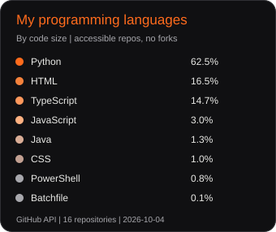
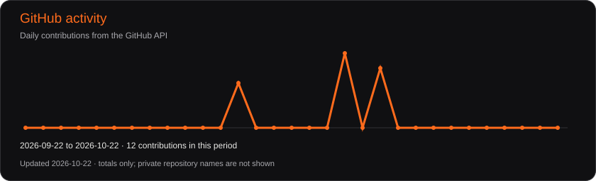

# 

I'm Jonas, based in Rio de Janeiro, Brazil. **I build desktop apps and organization systems** for managing projects, records, and everyday tasks. My personal and academic projects cover business management, content workflows, and practical automation.

## 

- **Work organization:** project boards, tasks, study libraries, and focus sessions.
- **Business management:** customer and product records, sales, and service orders.
- **Content workflows:** channel organization and separate local browser sessions.
- **Automation and data:** Python tools, database-backed apps, and Windows scripts.

## 

| Project | Purpose |
| --- | --- |
| **Editor Forge** | Windows app for Kanban tasks, study material, and focus sessions. |
| **TokFury** | Windows app for organizing TikTok channels and browser sessions; in development. |
| **InfoTechG** | Java / MySQL coursework: store records, sales, repair orders, and menus by user role. |
| **Auction system** | Java / MySQL coursework for registering products and tracking sales. |

I also have a private desktop analysis project whose details are kept private.

More applications — Java study projects

| Application | Purpose |
| --- | --- |
| **Cenaflix** | Video registration and podcast records. |
| **Appointment scheduler** | Register, list, and complete appointments. |
| **Measurement log** | Record measurements with dates, times, and notes. |
| **NutriSoft** | Screens for BMI, calorie, and macronutrient calculations. |
| **Sales calculator** | Calculate prices with discounts. |
| **Supermarket study** | Model products, shopping carts, and orders in a console exercise. |

The project repositories are private; the Java study applications are coursework.

## 

## 

The view counter counts image requests, so repeat visits may be counted more than once.

